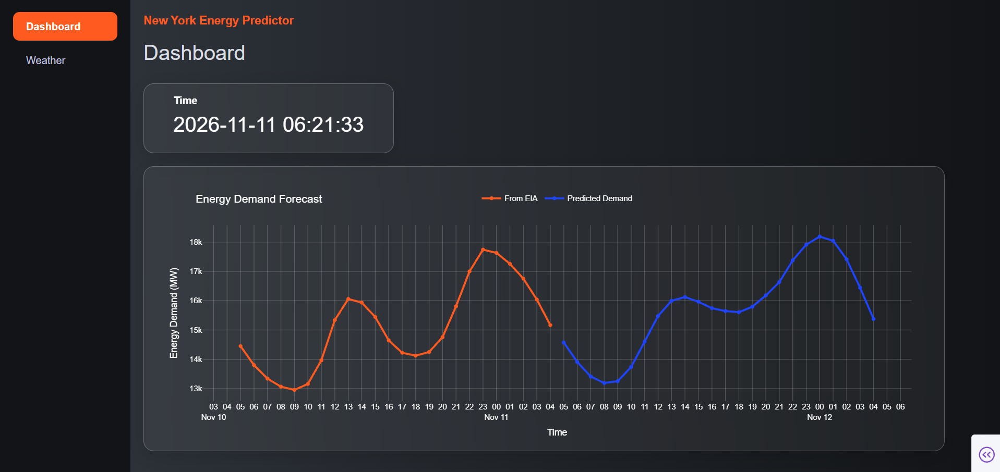
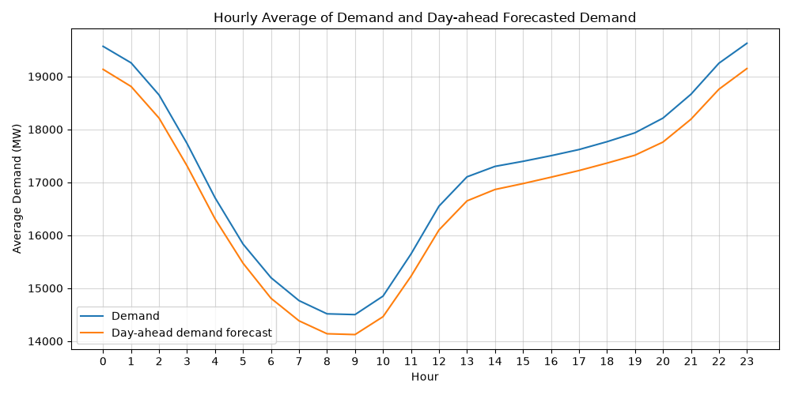
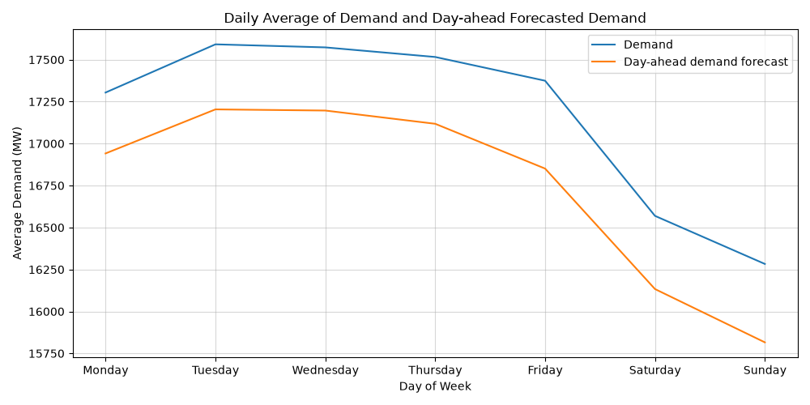
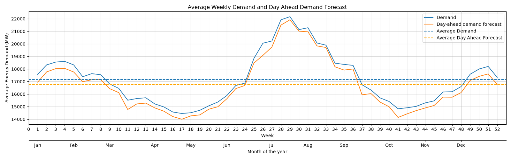
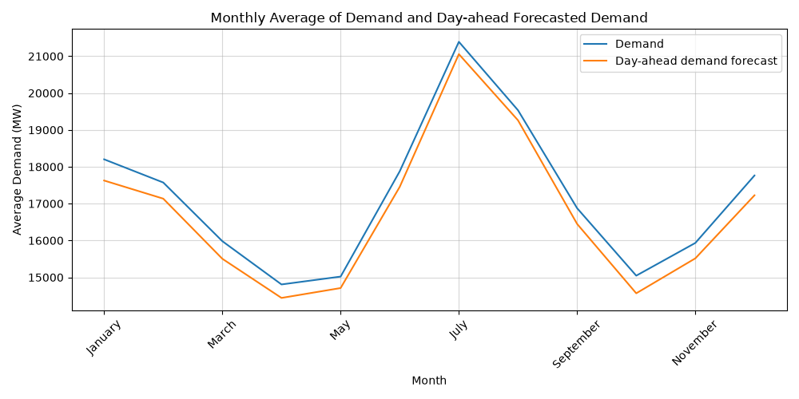
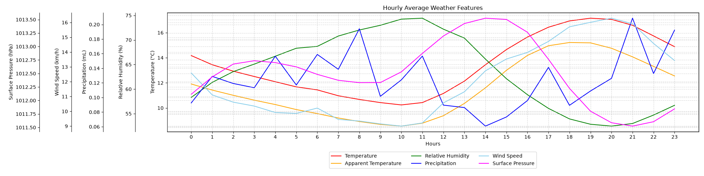
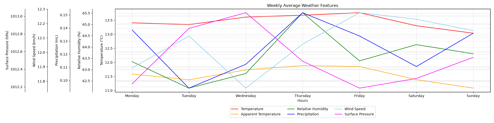
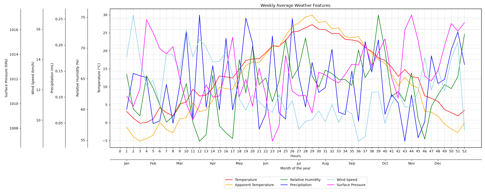
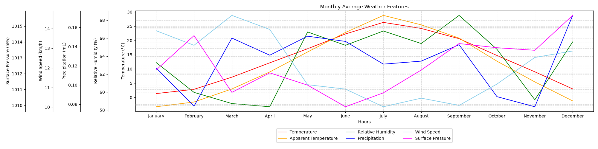
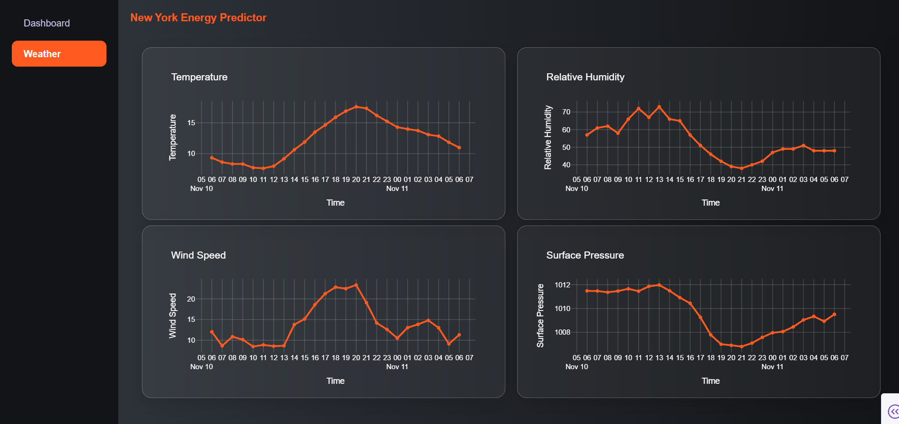

# NY Electricity Demand Forecasting
Time-Series Forecasting | Keras | EIA API | Open-Meteo

An end-to-end data science project for analyzing and forecasting electricity demand in New York using historical energy data and weather observations. The project explores time-series forecasting, evaluates machine learning models against baseline methods, and aims to deliver demand predictions through an interactive dashboard.

**Forecasting Region**: New York\
**Forecast Horizon**: 24 hours ahead\
**Primary Target**: Electricity Demand (MW)

**Live Dashboard**: [Dashboard Link](https://forecast-app-276745421099.europe-west1.run.app/)\
*Wait for sometime for cold start*



## Table of Contents
* [Overview](#overview)
* [Objectives](#objectives)
* [Data Sources](#data-sources)
* [Project Workflow](#project-workflow)
* [Exploratory Data Analysis](#exploratory-data-analysis)
* [Feature Engineering](#feature-engineering)
* [Forecasting Models](#forecasting-models)
* [Model Evaluation](#model-evaluation)
* [Interactive Dashboard](#interactive-dashboard)
* [Project Structure](#project-structure)
* [Installation](#installation)
* [Technology Stack](#technology-stack)
* [Limitations](#limitations)
* [Future Improvements](#future-improvements)

## Overview
Electricity demand varies over time in response to daily usage patterns, weekly cycles, seasonal changes, and weather conditions. Forecasting demand can help illustrate these patterns and provide estimates of near-term electricity consumption.

This project uses hourly electricity data from the U.S. Energy Information Administration (EIA) and weather data from Open-Meteo to investigate demand patterns and develop forecasting models.

The project follows a complete data science workflow:
* Acquire and inspect energy and weather data.
* Clean, align, and explore the datasets.
* Engineer time-series and weather-related features.
* Train and compare statistical and machine learning forecasting models.
* Evaluate predictions on a chronological holdout test set.
* Integrate the selected model into an interactive dashboard.
* Package the forecasting workflow for reproducible inference and deployment.

The goal is to build a transparent, reproducible forecasting application rather than only train a model in a notebook.

## Objectives
* Analyze hourly electricity demand and identify temporal patterns.
* Investigate relationships between demand, temperature, and other available weather variables.
* Establish simple forecasting baselines before evaluating more complex models.
* Develop an LSTM model for one-hour-ahead demand forecasting.
* Evaluate whether weather features improve predictive performance.
* Explore forecasting models for generating predictions beyond the next hour.
* Present historical demand, forecasts, and model evaluation metrics through an interactive dashboard.
* Develop a reusable inference workflow suitable for deployment.

## Data Sources
### Electricity Demand - EIA
Source: [U.S. Energy Information Administration API](https://www.eia.gov/opendata/)

The EIA API provides electricity-related time-series data for U.S. balancing authorities and regions. The project uses data for the New York Independent System Operator (NYIS).

Available fields depend on the selected EIA endpoint and data series. The dataset may include:
| Field | Description |
| -----	| ----------- |
| period | Timestamp associated with the observation |
| respondent | Balancing authority or region identifier |
| respondent-name | Name of the reporting region |
| type | Energy data series identifier |
| type-name | Description of the series |
| value | Reported measurement |
| value-units | Unit associated with the measurement |

The selected demand series serves as the forecasting target. Other series are used only where their availability and intended use are appropriate.

**Data frequency**: Hourly\
**Historical period**: ```2022-01-01``` to ```2026-11-01```\
**Target series**: ```Demand```\
**Target unit**: MW

### Weather - Open-Meteo
Source: [Open-Meteo Historical Weather API](https://open-meteo.com/en/docs/historical-weather-api)

Open-Meteo provides historical weather information at hourly resolution for supported variables and locations.

Weather variables collected for this project include:

* Temperature at 2 metres
* Relative humidity at 2 metres
* Apparent Temperature
* Precipitation
* Wind speed
* Surface Pressure

The weather dataset is aligned with the electricity dataset using timestamps. The resulting dataset is used to investigate whether weather conditions provide additional predictive information.

**Weather location**: New York City\
**Historical period**: ```2022-01-01``` to ```2026-11-01```

Historical weather data can be based on reanalysis or weather-model estimates rather than direct measurements at the exact location. The selected dataset and its limitations should therefore be considered when interpreting results.

***Important forecasting consideration***: Historical weather observations are suitable for retrospective analysis, but future weather observations cannot be assumed to be available when a real forecast is issued. Operational forecasting must use weather forecasts available at prediction time or a model that does not depend on future weather inputs.

## Project Workflow
The project is organized into the following stages:

**Data acquisition**
* Retrieve electricity data through the EIA API.
* Retrieve hourly weather data through Open-Meteo.
* Store the raw datasets separately from processed data.
* Record the time range, units, source parameters, and retrieval date.

**Data cleaning and alignment**
* Convert timestamps to a consistent timezone.
* Sort observations chronologically.
* Identify duplicate timestamps and missing periods.
* Check numerical columns for invalid values.
* Align energy and weather records at the appropriate hourly timestamps.
* Investigate missing observations before deciding whether to remove or impute them.
* Confirm the target's definition and units before calculating evaluation metrics.

**Exploratory data analysis**
* Analyze demand patterns through:
* Overall demand trends.
* Hour-of-day profiles.
* Day-of-week and weekday-versus-weekend comparisons.
* Monthly and seasonal patterns.
* Demand distributions and extreme observations.
* Missing data and temporal coverage.
* Relationships between demand and weather variables.

**Feature engineering**\
Create features using information that would be available at the time each forecast is issued.

Potential features include:
* Hour of day.
* Day of week.
* Month or season.
* Lagged demand.
* Rolling demand statistics.
* Temperature and other aligned weather variables.

The final feature set is determined by the experiments and the availability of each feature at prediction time.

**Model training and evaluation**\

* Split the data chronologically into training, validation, and test periods.
* Fit preprocessing transformations using training data only.
* Train baseline and machine learning models.
* Use validation performance for model selection and early stopping.
* Evaluate the selected models on the untouched test period.
* Compare errors in the target's original units.

**Forecast serving and visualization**

The selected model is packaged with its preprocessing artifacts. The inference workflow accepts recent observations, generates a prediction, and returns results for visualization.

The dashboard is intended to display historical demand, forecast demand, data freshness, and model performance.

## Exploratory Data Analysis
The EDA investigates the following questions:

* How does electricity demand vary throughout the day?
* Are there consistent differences between weekdays and weekends?
* How do monthly and seasonal demand patterns differ?
* Are demand peaks associated with unusually high or low temperatures?
* Which weather variables show the strongest association with demand?
* Are there missing timestamps, outliers, or structural changes in the data?
* Does recent demand provide a strong baseline for predicting the next hour?

### Visualizations
**Energy Data**






**Weather Data**






## Feature Engineering
The forecasting dataset combines the selected electricity target with the features used by each experiment.

| Feature group | Examples | Purpose |
| ------------- | -------- | ------- |
| Temporal | Hour, weekday, month | Capture recurring time patterns |
| Lagged Demand | Previous-hour demand, demand 24 hours earlier | Capture short-term dependence and daily seasonality |
| Rolling statistics | Rolling mean and standard deviation | Describe recent demand behaviour |
| Weather | Temperature, humidity, precipitation | Investigate weather-related demand variation |

## Forecasting Models
### Baseline Models
**Baseline and machine-learning models**<br>
The baseline notebook uses calendar features and demand-history features:
- Calendar: hour, day of week, month, and weekend indicator.
- Demand history: 1-hour, 24-hour, 48-hour, and 168-hour lags.
- Rolling statistics: 24-hour rolling mean and standard deviation.

The notebook evaluates:
- Ridge Regression as a regularized linear baseline.
- LightGBM as a gradient-boosted tree model.

**Keras LSTM: direct 24-hour forecasting**<br>
The dashboard forecasting model is a Keras LSTM trained to predict 24 future hourly demand values in one forward pass. It does not generate the 24-hour forecast by repeatedly feeding predictions back into the model.

Input sequence
- Previous 24 hours of observations.
- Standardized electricity demand.
- Six weather variables: temperature, relative humidity, apparent temperature, precipitation, wind speed, and surface pressure.
- Cyclical time features for hour, day of week, and month, plus a weekend indicator.<br>

Model architecture
- LSTM layer with 64 units.
- Dense layer with 64 units and ReLU activation.
- Dropout layer with a rate of 0.3.
- Dense layer with 32 units and ReLU activation.
- Output layer with 24 units, one for each forecast hour.

The model is trained with the Adam optimizer and mean absolute error loss. Early stopping restores the best validation weights, and the best model checkpoint is saved. The input-feature scaler and target scaler are saved separately and reused during inference.

### Data splitting and preprocessing
The Keras LSTM notebook uses a chronological split: 80% training, 10% validation, and 10% test. The target scaler and weather-feature scaler are fitted on the training partition and then applied to the validation and test data. The saved scalers must be used unchanged when generating forecasts.

## Model Evaluation

All models are evaluated using the same chronological test period for a fair comparison.

| **Model** | **Test MAE** | **Test RMSE** |
| --------- | ------------ | ------------- |
| Naive | 1570.90 | 2022.45 |
| Ridge | 344.97 | 452.40 |
| LightGBM | 135.92 | 196.01 |
| LSTM | 250.67 | 297.74 |

## Interactive Dashboard
The dashboard uses the Keras LSTM to generate a direct 24-hour electricity-demand forecast from the most recent 24 hours of demand, weather, and calendar features. It also presents the weather variables used by the forecasting pipeline.

The model, target scaler, and weather-feature scaler are loaded as separate artifacts during inference. The dashboard preprocessing must preserve the same feature order and scaling steps used during training.




## Project Structure
```text
ny-electricity-forecasting/
├── dashboard/
│	├─ assets/
│	├─ components/
│	├─ pages/
│	└─ utils/
├── data/
│	├─ processed/
│	└─ raw/
├── models/
├── notebooks/
│	├─ 01_EDA.ipynb
│	├─ 02_Baselines.ipynb
│	└─ 03_LSTM.ipynb
├── results/
│	└─ plots/
└── README.md
```

## Installation
### Clone the repository
```bash
git clone https://github.com/Nambiar99/ny-energy-forecast.git
```
### Create a virtual environment
```bash
python -m venv .venv
```
### Activate the environment
Windows
```bash
.venv\Scripts\activate
```
Linux / macOS
```bash
source .venv/bin/activate
```
### Install dependencies
```bash
pip install -r requirements.txt
```
### Run the dashboard
```bash
python app.py
```

## Technology Stack

| Area | Tools |
| ---- | ----- |
| Programming Language | Python |
| Data manipulation | Pandas, Numpy |
| Data acquisition | EIA API, Open-Meteo API |
| Visualization | Plotly, Matplotlib |
| Machine learning | Scikit-Learn |
| Deep Learning | Keras |
| Dashboard | Dash, Plotly |
| Deployment | Google Cloud |

## Limitations
* Electricity demand depends on factors beyond the weather and features included in this project.
* Historical weather estimates may differ from observations at the exact location represented by the energy data.
* Regional energy data and point-based weather data have different spatial coverage.
* Model performance may vary across seasons, holidays, and unusual demand conditions.
* Future weather variables must be available as forecasts or estimated separately for operational predictions.
* Reported model accuracy applies to the selected dataset and test period; it does not guarantee future performance.

## Future Improvements
* Evaluate the incremental value of weather features using controlled experiments.
* Improve missing-data handling and feature validation.
* Evaluate longer forecast horizons with horizon-specific metrics.
* Add automated tests for preprocessing, inference, and API responses.
* Implement model versioning and reproducible training configurations.
* Add data freshness checks and structured application logging.
* Containerize and deploy the application.
* Monitor forecasting errors as new observations become available.
* Document model limitations and retraining requirements.

***

**Built with Python, Keras, Scikit, Plotly, Dash and Pandas**


